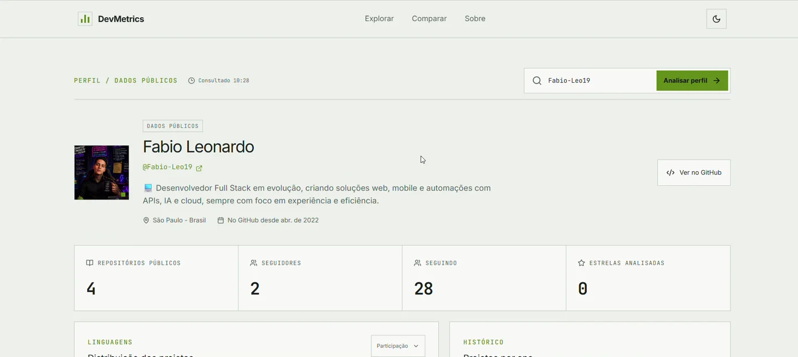
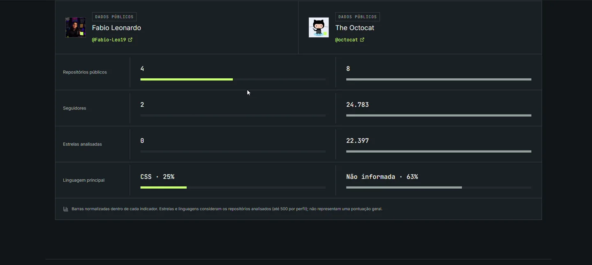

# DevMetrics

**Seu código conta uma história.**

Criei o DevMetrics para explorar perfis públicos do GitHub de um jeito mais visual. Você digita um usuário, vê como os projetos dele se distribuem e pode comparar duas trajetórias lado a lado. A comparação serve para conhecer os trabalhos, não para dar uma nota de quem é o melhor programador.

O layout começou no Figma. Depois transformei o protótipo em uma aplicação React que consulta a API pública do GitHub e monta os painéis com dados reais.

## Um pouco do visual

### Perfil e repositórios



### Comparação de perfis



*Capturas da aplicação rodando localmente. Os números são os que o GitHub retornou naquele momento e podem mudar.*

## O que dá para fazer

- Pesquisar usuários públicos do GitHub.
- Ver repositórios, estrelas, forks e histórico de projetos.
- Explorar a distribuição das linguagens principais por participação ou quantidade.
- Comparar duas contas sem transformar os números em um ranking.
- Alternar entre os temas claro e escuro.
- Usar o painel em telas menores, com estados de carregamento, perfil vazio e falhas de consulta.

A página inicial mostra apenas o **modelo visual** do dashboard, sem atribuir números inventados a uma pessoa real. Os números aparecem depois de fazer a pesquisa.

## Rodando localmente

É necessário ter o **Node.js 24 ou superior** instalado.

```bash
npm install
npm run dev
```

O terminal mostra o endereço para abrir no navegador (geralmente `http://localhost:5173`).

No PowerShell do Windows, você pode usar `npm.cmd install` e `npm.cmd run dev` caso o comando `npm` seja bloqueado pela política de scripts.

Para rodar os testes e conferir o build:

```bash
npm test
npm run build
```

O build final fica na pasta `dist`.

## Como os dados são calculados

O projeto usa a [API REST pública do GitHub](https://docs.github.com/pt/rest), sem exigir login ou token do visitante.

- **Repositórios, seguidores e seguindo:** vêm diretamente do perfil público.
- **Estrelas analisadas:** soma das estrelas dos repositórios consultados; não é a quantidade de repositórios que o usuário favoritou.
- **Linguagens:** usa a linguagem principal informada pelo GitHub em cada repositório. Não mede linhas de código.
- **Histórico:** agrupa os repositórios por ano de criação, exibindo até seis anos distintos.

Para evitar consultas excessivas, analiso até **500 repositórios por perfil**. Se uma pessoa tiver mais que isso, o painel sinaliza o recorte. Os resultados ficam em memória por cinco minutos; atualizar a página limpa esse cache.

Como a API pública limita chamadas sem autenticação, um uso muito intenso pode gerar um aviso para tentar novamente mais tarde. A busca também trata usuário inexistente, falha de conexão e resposta inesperada. Existe um botão para refazer a consulta.

## Organização do projeto

```text
src/
  App.tsx          telas, navegação e componentes
  index.css        estilos e responsividade
  lib/github.ts    consulta à API e cálculo das métricas
tests/
  github.test.mjs  testes de validação, métricas e erros
docs/screenshots/  capturas do projeto em funcionamento
```

Tecnologias: **React, TypeScript, Vite, React Router, Tailwind CSS e Lucide**. Fiz os gráficos com CSS porque queria manter a interface leve e fiel ao protótipo.

## Publicação

Para publicar como um site estático no Netlify:

- Comando de build: `npm run build`
- Pasta de publicação: `dist`

O arquivo `public/_redirects` já está incluído para que rotas como `/perfil/octocat` também funcionem quando abertas diretamente ou atualizadas no navegador.

## O que ainda quero explorar

- Filtros por linguagem e período.
- Links compartilháveis de comparações.
- Exportação de um resumo do perfil.

Projeto pessoal de **Fabio Leonardo**.
